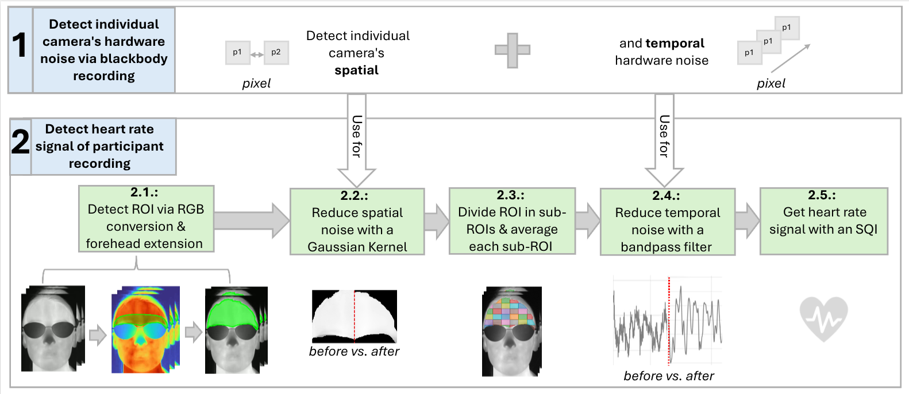

# Facial Heart-Rate Estimation with a Thermal Camera

**This project analyses the applicability of the heart rate detection based on temperature changes in facial vessels.** 

It includes every step needed for this investigation:
- Thermal-camera data acquisition, to get the facial videos with a thermal camera.
- Novel facial ROI detection method, that to the best of our knowledge outperforms current ROI detection methods for thermal cameras.
- Heart rate detection approaches: Reimplementation of two successful papers, and a novel approach that focuses specifically on removing a specific thermal camera's hardware noise.
- ECG ground-truth handling
- Evaluation of heart rate estimation

## Workflow

### 1. Data acquisition
To record with a Lepton 3.5, please follow the described steps here: 
`src/video_processing_methods/README.md`  
This pipeline makes sure that the timestamps of the recorded frames are from the internal Lepton clock instead of the computer, avoiding any misalignment.

Please also check out `src/cameras_pipelines` as it includes the pre-processing steps to get the recording data in the right format for several cameras.

### 2. ROI and heart rate detection
This repo has the following three heart rate detection approaches, all run the ROI detection automatically as part of their pipeline:

- **New approach**: Own, novel approach which focuses on separating the individual camera's hardware noise from the heart rate signal. 

Overview of own approach:

  

- **Nair et al.**: Reimplementation of 
> Nair KS, Sarath S.
> Illumination Invariant Non-Invasive Heart Rate And
> Blood Pressure Estimation From Facial Thermal Images using Deep Learn-
> ing. 2021 12th Int Conf Comput Commun Netw Technol (ICCCNT). 2021.
> doi:10.1109/ICCCNT51525.2021.9579621.

- **Yang et al.**: Reimplementation of 
> Yang C, Hu M, Zhai G, Zhang XP. Graph-Based Denoising for Respiration and
> Heart Rate Estimation During Sleep in Thermal Video. IEEE Internet Things J.
> 2022;9(17). doi:10.1109/JIOT.2022.3150147.

Please run all three approaches with: `scripts/run_batch.py`

### 3. ECG ground-truth extraction and alignment

Please see `src/ground_truth_methods/README_ground_truth.md` to see which pipeline to run, depending on which input format your ECG file has.

### 4. Evaluation

Please run `src/metrics/metric_pipeline.py`.  
See `src/metrics/README.md` for more information.

## Requirements

See `requirements.txt`